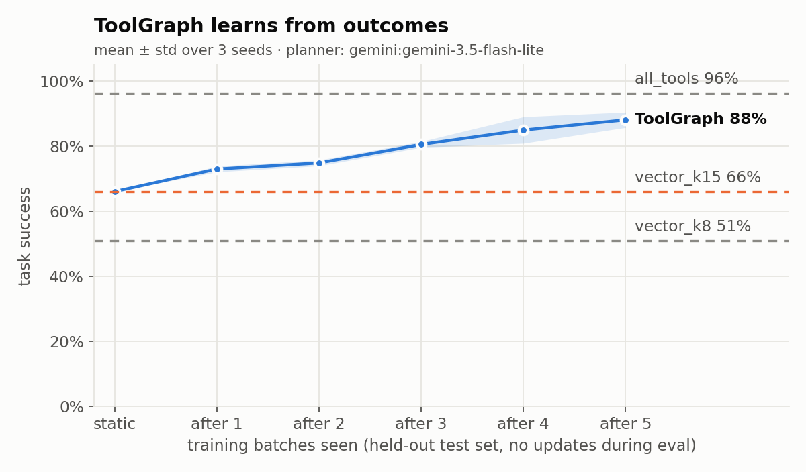
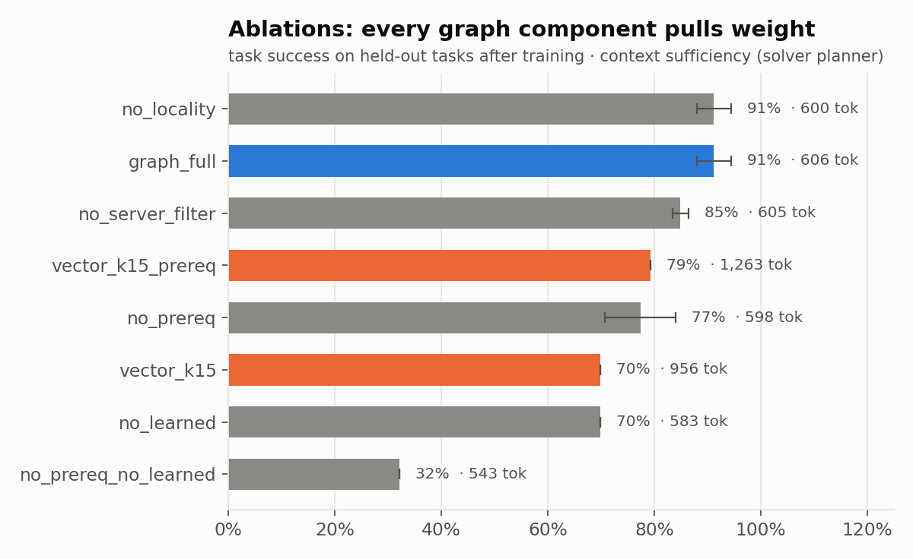
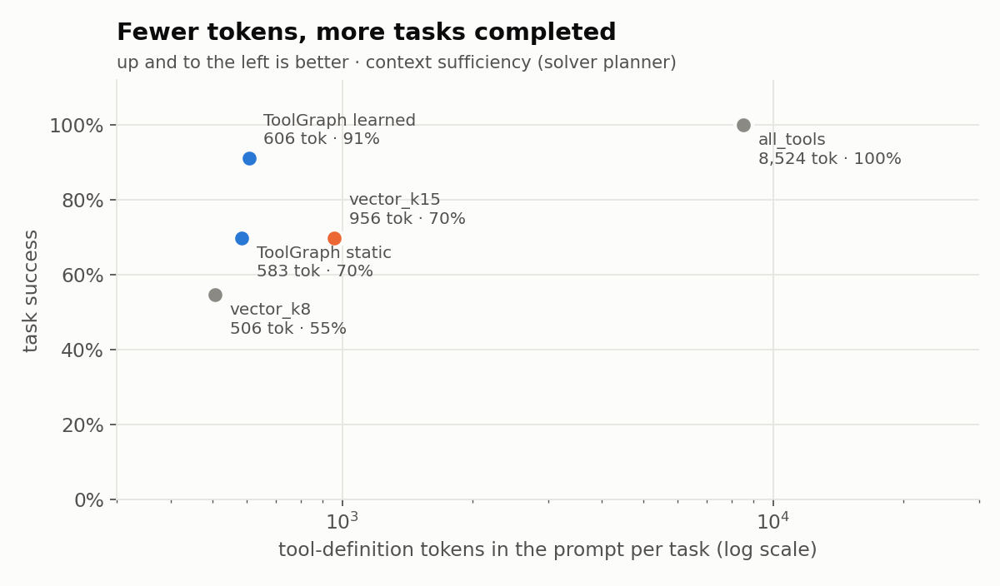
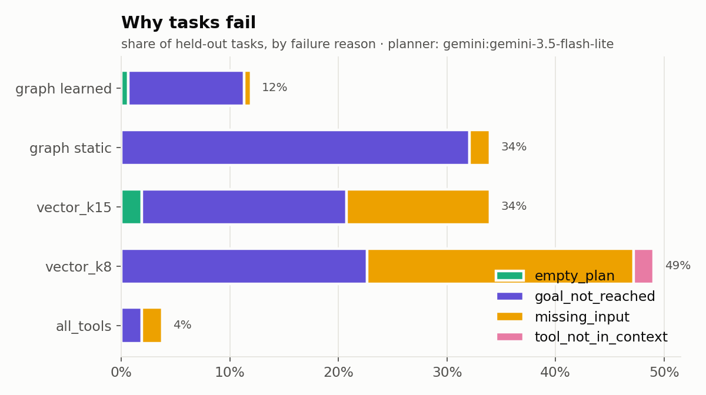
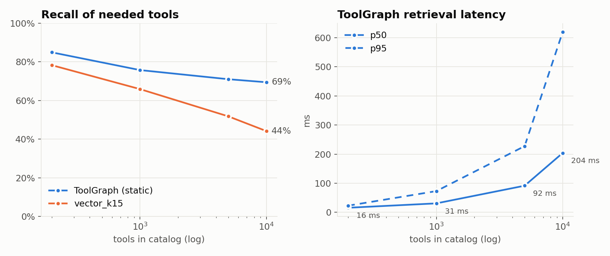

# ToolGraph

**Your agent doesn't need 200 tools in context. It needs the right 6.**

ToolGraph is a tool router for AI agents. It stores MCP tools, the capabilities they provide and the typed data they consume and produce as a graph in [HydraDB](https://github.com/hydra-db/hydradb). For each task it traverses that graph and returns only the tools needed, **including the prerequisite tools** that vector search misses. It also learns from outcomes, so routing improves with use.

**Live demo:** [app-production-17690aee.up.railway.app](https://app-production-17690aee.up.railway.app) · **Walkthrough (Loom):** _link added after recording_ · HydraDB Hackathon, Track 2

<!-- gen:headline -->
On 53 held-out tasks with an LLM planner (`gemini:gemini-3.5-flash-lite`, 3 seeds): ToolGraph goes from **66% → 88% task success** as it learns from outcomes, vs **66%** for vector top-15 and **96%** with every tool in context, while sending **607 tool tokens per task instead of 8,524** (−93%). With a perfect solver planner instead (context sufficiency), on the same 53 held-out tasks (3 seeds; context sufficiency: the planner is an LLM-free solver that finds the shortest valid plan using **only the retrieved tools**, so success measures whether retrieval put enough in context): ToolGraph goes from **70% → 91% task success** as it learns from outcomes, vs **70%** for vector top-15, while sending **606 tool tokens per task instead of 8,524** (−93%) with all tools in context. (All tools in context scores 100% here by construction: a perfect planner is never confused by extra tools, so this setting only shows what extra context *costs*; the LLM-planner run shows what it does to accuracy.)
<!-- /gen:headline -->



## Use it (hosted, free)

1. **Get a workspace key:** [app-production-17690aee.up.railway.app/app](https://app-production-17690aee.up.railway.app/app). It's free, with no card and no LLM key. Routing is LLM-free, and your own agent does the planning.
2. **Bring your tools**, either of two ways:
   - `toolgraph sync --key tg_...` uploads the tool definitions of every MCP server already configured in Claude Code, Claude Desktop or Cursor. Only names, descriptions and schemas leave your machine; env vars and tokens don't.
   - Or, in the dashboard: paste a `tools/list` JSON, give a remote MCP URL, or pick presets.
3. **Connect your agent** to the hosted MCP endpoint:

```bash
claude mcp add --transport http toolgraph https://app-production-17690aee.up.railway.app/mcp --header "Authorization: Bearer tg_..."
# Claude.ai → Settings → Connectors → custom connector URL: https://app-production-17690aee.up.railway.app/mcp/tg_...   (secret URL)
# Cursor: {"mcpServers": {"toolgraph": {"url": "https://app-production-17690aee.up.railway.app/mcp", "headers": {"Authorization": "Bearer tg_..."}}}}
```

Your agent calls `find_tools(task)` and gets back only the tools that task needs. Each one comes with *why*: a direct match, or a prerequisite (e.g. `slack_list_channels` because it produces the `channel_id` that `slack_post_message` needs). After the task, the agent calls `report_outcome(task, tools, success)`, and your workspace's graph learns which chains work. The REST API is the same: `POST /v1/find_tools`, `POST /v1/outcome`.

**How your tools become a graph.** Plain MCP schemas carry no types, so ToolGraph infers them (`backend/app/infer.py`):
- *consumes*: required reference parameters (`channel_id`, `teamId`, `owner`/`repo`, `pull_number`), scoped per server.
- *produces*: lookup or create verbs on the same entity (`list_channels` → `channel_id`; `create_issue` → `issue_number`), or the parameter appearing in `outputSchema`.
- *capabilities*: canonical verb.object (`post_message` and `send_message` → `send.message`), shared across servers.

Each workspace lives in its own vertex-id block of the same HydraDB graph, so the retrieval and learning code is the code the benchmark below measures.

---

## The problem

Agents now connect to many MCP servers, and every tool definition sits in the prompt on every call:

- **Tokens and cost.** 134 tools across 15 servers is ~8.5k tokens of tool JSON per call before the task starts. Real fleets are larger.
- **Wrong-tool errors.** Look-alike tools across servers (Slack vs Discord, GitHub vs GitLab) crowd the window and get confused.
- **Vector search alone isn't enough.** "Post the failing CI log to #incidents" is semantically close to `post_message` and `get_workflow_run_logs`. But the agent also needs `find_channel` (to turn `#incidents` into a channel id) and `list_workflow_runs` (to get a run id). Those prerequisites share no words with the task. They are only reachable by following typed inputs to the tools that produce them, and that is a graph walk.

## How it works

```
Agent ──task + inputs it has──▶ ToolGraph API ──Cypher──▶ HydraDB 0.3 (graph-node + graph-indexer + object store)
  ▲                              │ 1. seed  2. traverse  3. rank + chain-complete
  └──────── ~6–10 tools ─────────┘
Simulator outcome ──▶ learner ──▶ SOLVED_WITH / NEXT edge weights written back to HydraDB
```

**Schema** (all in HydraDB):

| edge | meaning |
|---|---|
| `(Tool)-[:PROVIDES {weight}]->(Capability)` | what a tool is for (71 capabilities) |
| `(Tool)-[:CONSUMES]->(DataType)` | required inputs, typed: a Slack channel id is not a Discord channel id (117 types) |
| `(DataType)-[:PRODUCED_BY]->(Tool)` | who can produce an input: **the prerequisite edge** |
| `(Tool)-[:PART_OF]->(Server)` | MCP server membership (15 servers, 134 tools) |
| `(Intent)-[:SOLVED_WITH {weight}]->(Tool)` | learned: a cluster of similar tasks → tools that worked |
| `(Tool)-[:NEXT {weight}]->(Tool)` | learned: "often called right after" |

**Retrieval**
1. **Seed (Python).** Embed the task and pick the top capabilities, scoring each by its own description and by the tools that provide it. Add the best capability for every server the task names. Then match learned intents: masked task text, plus the servers named, plus the inputs the user already gave. The types the user supplied go in as `$known`.
2. **Traverse (HydraDB).** One seed query, then one id-anchored hop query per prerequisite level (depth 4) over the whole frontier. Chains stay on the servers the task names plus the servers of the most similar tools.
3. **Rank and chain-complete (Python).** Rank goal-serving tools by capability similarity × server match + learned `SOLVED_WITH` weight. For each selected tool, recursively add the cheapest producer of every input that isn't known yet (`chain_cost`), until the 10-tool budget is used.

Traversal query, generated from the code:

<!-- gen:cypher -->
```cypher
// round trip 1: seeds (capabilities, matched learned intents, learned NEXT edges)
MATCH (t0:Tool)-[r:PROVIDES]->(c:Capability)
  WHERE c.id IN $caps
  RETURN c.id AS src, c.id AS via, t0.id AS dst, r.weight AS w
UNION ALL
MATCH (i:Intent)-[r:SOLVED_WITH]->(t0:Tool)
  WHERE i.id IN $intents
  RETURN i.id AS src, i.id AS via, t0.id AS dst, r.weight AS w
UNION ALL
MATCH (c:Capability)<-[:PROVIDES]-(t0:Tool)-[r:NEXT]->(n:Tool)
  WHERE c.id IN $caps AND r.weight >= 1.5
  RETURN t0.id AS src, t0.id AS via, n.id AS dst, r.weight AS w

// then once per prerequisite level, for the whole frontier of tools found so far
MATCH (t:Tool)-[:CONSUMES]->(d:DataType)
  WHERE t.id IN $frontier AND NOT d.id IN $known
  OPTIONAL MATCH (d)-[:PRODUCED_BY]->(p:Tool)
  RETURN t.id AS src, d.id AS via, p.id AS dst, p.server AS server
```
<!-- /gen:cypher -->

**Learning** uses only simulator feedback (success, or which type was missing), never gold labels. The held-out test set never updates the graph.

| outcome | update |
|---|---|
| success | `NEXT` +0.3 between consecutive plan steps; `SOLVED_WITH` +0.5 from the task's intent to every tool used |
| failure: `missing_input:T` / `goal_not_reached:T` | ask HydraDB who produces `T`, preferring producers on named servers with grounded inputs; `SOLVED_WITH` +0.25 to that producer |
| failure | −0.2 on learned edges the failed plan used; all weights clamped to [0, 5] |

An intent is a task cluster. A new task joins the nearest intent when cos(masked text) + 0.35·Jaccard(servers named) + 0.25·[same inputs supplied] ≥ 0.825. That threshold was calibrated on the **train split only** (`scripts/calibrate_intent.py` → `results/intent_calibration.json`).

### Why frontier traversal instead of one big query

The first version sent everything as one deep `UNION ALL` query, one round trip. It matched the current results at 134 tools. At 1,000 tools, though, 4-level chain patterns expand before they filter, and p50 went to seconds (numbers in the scale table below). Seeding plus one hop query per level keeps every query anchored on a small set of ids. It costs ~3.5 round trips instead of 1, and stays in the hundreds of ms at 10,000 tools. Both variants live in `backend/app/retrieve/graph.py` (`traversal="frontier" | "union"`).

## Why a graph: would this fall apart on a plain store?

Each graph component switched off in turn, after the same training:

<!-- gen:ablations -->
Source: `results/ablations_sufficiency.json` (context sufficiency: the planner is an LLM-free solver that finds the shortest valid plan using **only the retrieved tools**, so success measures whether retrieval put enough in context); all graph variants share the same learned state.

| variant | what changes | task success | tool recall | tool tokens |
|---|---|---|---|---|
| `graph_full` | full ToolGraph | 91.2% ± 3.2 | 95.3% ± 1.3 | 606 |
| `no_locality` | no locality pruning (chains may use any server) | 91.2% ± 3.2 | 94.3% ± 1.7 | 600 |
| `no_server_filter` | no boost for servers the task names | 84.9% ± 1.5 | 91.3% ± 1.3 | 605 |
| `vector_k15_prereq` | vector top-15 + keyword prerequisite heuristic (no graph) | 79.2% ± 0.0 | 90.7% ± 0.0 | 1,263 |
| `no_prereq` | no prerequisite expansion (capability seeds only) | 77.4% ± 6.7 | 87.6% ± 2.9 | 598 |
| `no_learned` | no learned edges (static graph) | 69.8% ± 0.0 | 86.8% ± 0.0 | 583 |
| `vector_k15` | plain vector store, top-15 | 69.8% ± 0.0 | 84.0% ± 0.0 | 956 |
| `no_prereq_no_learned` | neither: capability lookup only | 32.1% ± 0.0 | 63.6% ± 0.0 | 543 |
<!-- /gen:ablations -->

- Removing prerequisite expansion or learned edges each costs a large share of success.
- Removing both (capability lookup alone) collapses it.
- Giving a plain vector store a keyword prerequisite heuristic recovers part of the gap, but needs about twice the tokens, and still trails the graph. The gain comes from the typed `CONSUMES → PRODUCED_BY` structure, not from a bigger k.



## Results

<!-- gen:results -->
Source: `results/sufficiency.json`, context sufficiency: the planner is an LLM-free solver that finds the shortest valid plan using **only the retrieved tools**, so success measures whether retrieval put enough in context. Mean ± std over 3 seeds; 96 train / 53 test tasks. Retrieval latency is measured with 8 tasks in flight.

| strategy | task success | tool recall | tool tokens / task | input $ / 1k tasks | DB round trips | retrieval p50 / p95 |
|---|---|---|---|---|---|---|
| `all_tools` | 100.0% ± 0.0 | 100.0% ± 0.0 | 8,524 | $8.52 | 0 | 0.0 / 346.0 ms |
| `vector_k8` | 54.7% ± 0.0 | 72.1% ± 0.0 | 506 | $0.51 | 0 | 1.5 / 87.7 ms |
| `vector_k15` | 69.8% ± 0.0 | 84.0% ± 0.0 | 956 | $0.96 | 0 | 0.4 / 0.7 ms |
| graph, static (iteration 0) | 69.8% ± 0.0 | 86.8% ± 0.0 | 583 | $0.58 | 3.5 | 44.5 / 89.5 ms |
| **graph, after 5 training batches** | 91.2% ± 3.2 | 95.3% ± 1.3 | 606 | $0.61 | 3.3 | 46.5 / 78.5 ms |

Learning curve (held-out success after each of 5 training batches, mean of seeds): 70% → 79% → 81% → 87% → 91% → 91%.

Failure reasons, summed over seeds: vector_k15: empty_plan 9, goal_not_reached 39; graph static: goal_not_reached 48; graph learned: goal_not_reached 14.
<!-- /gen:results -->

 

**With a real LLM planner.** The same benchmark with the solver swapped for an LLM that writes the plan from the retrieved tool definitions:

<!-- gen:llm -->
Source: `results/benchmark.json`, LLM planner `gemini:gemini-3.5-flash-lite`, mean ± std over 3 seeds, same 96 train / 53 test split. Here extra tools can confuse the planner, so all-tools is no longer perfect.

| strategy | task success | tool recall | tool tokens / task |
|---|---|---|---|
| `all_tools` | 96.2% ± 0.0 | 100.0% ± 0.0 | 8,524 |
| `vector_k8` | 50.9% ± 0.0 | 72.1% ± 0.0 | 506 |
| `vector_k15` | 66.0% ± 0.0 | 84.0% ± 0.0 | 956 |
| graph, static (iteration 0) | 66.0% ± 0.0 | 86.8% ± 0.0 | 583 |
| **graph, after 5 training batches** | 88.1% ± 2.4 | 94.5% ± 0.7 | 607 |

Learning curve (mean of seeds): 66.0% → 73.0% → 74.8% → 80.5% → 84.9% → 88.1%.
<!-- /gen:llm -->

**Scale.** To crowd the catalog, I cloned real servers into look-alike servers: same capabilities, brand-specific id types and shared user-supplied types. The tasks still name the real servers.

<!-- gen:scale -->
Source: `results/scale.json` (static graph, no learned edges; sufficiency = solver planner).

| tools in catalog | all-tools tokens | graph tokens | graph recall | vector_k15 recall | graph sufficiency | vector_k15 sufficiency | graph p50 / p95 | ingest |
|---|---|---|---|---|---|---|---|---|
| 200 | 13,305 | 626 | 85% | 78% | 68% | 64% | 14 / 23 ms | 1.4 s |
| 1,000 | 66,637 | 676 | 76% | 66% | 57% | 45% | 34 / 73 ms | 3.7 s |
| 5,000 | 333,565 | 676 | 71% | 52% | 53% | 34% | 108 / 273 ms | 16.7 s |
| 10,000 | 668,862 | 675 | 69% | 44% | 51% | 28% | 244 / 693 ms | 47.1 s |

Single deep `UNION ALL` query instead of frontier traversal (first 20 test tasks): 200 tools p50 173 ms / p95 580 ms; 1,000 tools p50 1646 ms / p95 12319 ms.
<!-- /gen:scale -->



**Load** (`POST /api/retrieve`, graph strategy, retrieval only):

<!-- gen:load -->
Source: `results/load.json`, hosted deployment, host `https://app-production-17690aee.up.railway.app`. Locust headless; mix = 4x POST /api/retrieve (graph, held-out task texts) : 1x GET /api/graph/stats.

| concurrent users | duration | retrieve RPS | p50 | p95 | p99 | errors |
|---|---|---|---|---|---|---|
| 50 | 3m | 70.7 | 300 ms | 1000 ms | 2500 ms | 0.00% |
| 200 | 3m | 139.5 | 900 ms | 1700 ms | 3500 ms | 0.00% |
<!-- /gen:load -->

## What's measured, exactly

- **Task success (primary).** A plan succeeds if every step's tool was in the retrieved context, every input was available when the step ran (given by the user or produced by an earlier step), and the goal types exist at the end (`backend/app/simulator.py`). Failure reasons: `tool_not_in_context`, `missing_input:<type>`, `goal_not_reached:<type>`, `empty_plan`, `too_many_steps`.
- **Planner.** `PLANNER_BACKEND=llm` uses an LLM at temperature 0 with only the retrieved tool definitions (the published run: `gemini-3.5-flash-lite` via `LLM_PROVIDER=gemini`; Anthropic and Groq are also supported). Every call is cached in `.cache/llm/`. `PLANNER_BACKEND=solver` swaps in an LLM-free planner: it finds the shortest valid plan using only the retrieved tools, which isolates whether retrieval put enough in context ("context sufficiency"). Every table says which planner produced it.
- **Tasks.** 149 tasks from 47 task families (1–5 steps; 37% have 1–2 steps, 32% have 3, 31% have 4–5). The split is stratified, with a third of each family held out (96 train / 53 test). Gold tool lists come from a shortest-plan solver. They're used only to report recall, never for learning.
- **Fairness.** Every strategy gets the user's supplied inputs: in words for the planner, appended to the vector query, and as `$known` for the graph.

## Honest limitations

- **Synthetic, simulated.** The catalog is modelled on real MCP servers but hand-built. Tasks are templated, and execution is simulated over typed inputs and outputs, not real API calls.
- **Small catalog.** 134 real-shaped tools. The scale test uses synthetic look-alikes, and real fleets are messier.
- **Learning needs repetition.** Learning helps task families it has seen. A brand-new kind of task gets the static graph.
- **Not built:** entity memory (remembering resolved ids such as "#incidents → C024") and learned multi-hop skill shortcuts. Both were cut for time.
- **Workspace typing is heuristic.** For your own tools, types are inferred from parameter names and tool names. It's reliable for id-style parameters (`*_id`, `*_number`, `owner`/`repo`), but it misses outputs that are only described in prose (e.g. a `ts` returned by `post_message`). Tools may carry explicit `consumes`/`produces` to override it. The benchmark numbers come from the hand-typed demo catalog, not from inferred workspaces.
- **Partial coverage.** Retrieval is ~3.5 HydraDB round trips per task, and tool recall is not 100%.

## Install from the command line

```bash
pipx install git+https://github.com/ivarunchaudhary/toolgraph   # or: pip install git+https://...
export TOOLGRAPH_URL=https://app-production-17690aee.up.railway.app   # try it against the hosted demo, no Docker needed
# or run your own:
toolgraph up                     # fetches the repo to ~/.toolgraph, starts HydraDB + app in Docker → http://127.0.0.1:8000
toolgraph route "post the failing CI logs for my repo to the #eng slack channel"
toolgraph compare "open a linear issue for the newest pagerduty incident"
toolgraph status                 # server + HydraDB health, node/edge counts
```

The CLI has no Python dependencies; it talks HTTP to a ToolGraph server (`--url` or `TOOLGRAPH_URL`, default `http://127.0.0.1:8000`). `toolgraph up` needs Docker and git.

**Use it from an agent (MCP).** `toolgraph mcp` runs an MCP server on stdio with a `find_tools(task, given?, budget?)` tool that returns only the tool definitions a task needs, prerequisites included:

```bash
claude mcp add toolgraph -- toolgraph mcp
claude mcp add toolgraph -e TOOLGRAPH_URL=https://app-production-17690aee.up.railway.app -- toolgraph mcp   # against the hosted demo
```

## Run it locally

```bash
git clone https://github.com/ivarunchaudhary/toolgraph && cd toolgraph
cp .env.example .env                       # optional: an LLM key (LLM_PROVIDER=anthropic|gemini|groq) for the LLM planner
docker compose --profile app up -d --build # HydraDB node + indexer + app → http://localhost:8000
```

Development / reproducing results (Python 3.11):

```bash
uv venv -p 3.11 .venv && uv pip install -p .venv -r requirements.txt
docker compose up -d hydradb hydradb-indexer
make ingest            # catalog → HydraDB (idempotent)
make test
make bench             # LLM planner: 3 seeds × 5 batches → results/benchmark.json + ablations.json
make sufficiency       # LLM-free: → results/sufficiency.json + ablations_sufficiency.json
make scale plots       # → results/scale.json, results/plots/*.png
make load HOST=http://127.0.0.1:8000
python scripts/readme_results.py   # rewrites every number in this README from results/*.json
```

Deploying (Railway: two services + a volume): see [`infra/README.md`](infra/README.md). Check a deploy with `./infra/smoke.sh https://<host>`.

## Who pays

- **Buyers:** teams running agents across many MCP servers (internal copilots, support and ops agents), agent-platform companies, and MCP gateway vendors.
- **Pain:** context bloat (cost and latency), tool-selection errors, and accuracy that degrades as catalogs grow. See the scale table: vector recall falls much faster than the graph's.
- **Offer:** a hosted MCP meta-tool and API (`find_tools`, `report_outcome`) that any agent adds by URL. The learned state is the moat: it gets better on *your* workload.
- **Pricing:** **Free** $0 (1 workspace, 300 tools, 10k `find_tools`/month, learning from outcomes). **Team** $29/month (several workspaces, shared team learning, usage analytics; coming soon). **Enterprise:** self-host on your own HydraDB. Free during launch; no billing is wired up yet.
- **Who saves what:** agent builders paying per token send ~600 tool tokens per task instead of ~8.5k (input $ per 1k tasks is in the results table). Users on flat plans (Claude Pro, Cursor) get a cleaner context and fewer wrong-tool picks. Claude Code already defers MCP tools with its own tool search. ToolGraph adds typed prerequisite chains, learning from outcomes, and one graph for any agent.
- **Proof points:** the success delta vs all-tools and vector search, the token reduction, and input cost per 1k tasks. All are in the tables above and regenerated from `results/`.

## Repo map

```
backend/app/        config, db (HydraDB HTTP client), catalog, ingest, embed, tokens,
                    retrieve/{all_tools,vector,graph}.py, simulator, planner, llm (cached), learner, main (FastAPI)
toolgraph_cli/      toolgraph CLI (route/compare/sync/find) + MCP stdio server (stdlib only; thin client of the API)
                    ctx (active workspace), workspaces (keys, persistence), infer (schema → types), saas (REST + hosted MCP)
frontend/           index.html (landing) · app.html (workspace dashboard) · playground.html (benchmark: route, compare, results, how it works)
data/               catalog/<server>.json, taxonomy.json, tasks/{train,test}.jsonl
eval/               run_benchmark.py, ablations.py, scale_test.py, plots.py
scripts/            build_catalog.py, generate_tasks.py, smoke_hydradb.py, calibrate_intent.py, readme_results.py
loadtest/           locustfile.py, run_load.py
infra/              hydradb/ (single-container launcher), smoke.sh, README.md (deploy)
results/            every number and chart, written by the scripts above
```

## Credits and license

- [HydraDB](https://github.com/hydra-db/hydradb) v0.3.0 (AGPL-3.0) is the graph database. It's used unmodified as an external service via its published image `ghcr.io/hydra-db/hydradb:0.3.0`, and none of its code is vendored here. `scripts/smoke_hydradb.py` records which Cypher features this project relies on (`results/phase0_capabilities.json`).
- Embeddings: `sentence-transformers/all-MiniLM-L6-v2` via fastembed (ONNX). Token counts: tiktoken `o200k_base`.
- ToolGraph is MIT licensed (see `LICENSE`).
